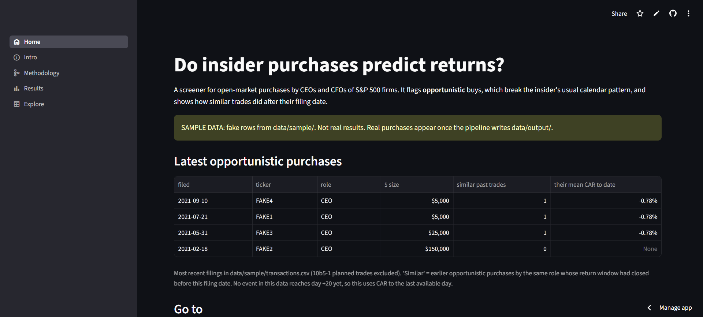

# Do CEO and CFO Purchases Predict Returns?

**Team:** WACC Warriors

**Members:** Vincent Batten, Eric Schneps, David Kyle

**Live dashboard:** https://fin331-finalproject.streamlit.app/

---

## 1. The question

**When the CEO or CFO of an S&P 500 company buys their own stock, does the stock beat the market over the next month, and is that signal stronger when the purchase deviates from the insider's regular practices?**

Executives, competent ones at least, should know more about their companies than do investors. Therefore, when they spend their own money buying their stock, in theory, they are the most informed investor. And being the most informed means their trades should be making profit. Despite this, many insider purchases are simply routine. Some executives make purchases after bonuses, or every year on a certain date. These transactions do not interest us because they are not placed on the idea that the stock is undervalued. Our team wants to distinguish between these "routine" traders and "opportunistic" ones, meaning insiders whose purchases are not routine. And we would like to see if opportunistic purchases can actually predict abnormal returns. We can achieve this goal using a fresh sample of large-cap companies constructed from publicly available data, and seeing whether or not their is significant deviation between the expected and actual returns (i.e., does their seem to be a timing component of their investments?)

**Who would pay for this?** An equiter researcher would be the best fit. Platforms for retail traders already display insider buying as a simple raw feed like "CEO bought $250k of _____". But these simple analyses cannot differentiate between "routine" from "opportunistic" purchases. For an equity researcher, identifying a buy or sell for an insider could represent a significant opportunity in the market, where a trader can match this position either long or short.

---

## 2. The data

### Unit of observation

Each row represents an open-market purchase made by a CEO or CFO of a single firm from a Form 4 filing. We dated the event according to the day when the filing becomes available at the SEC, because this is the first day an outside investor could have learned of the trade. Rows below represent an output of our first end-to-end run for 10 randomly chosen S&P 500 companies.

| accession | ticker | role | filing_date | trans_date | usd_value | is_10b5_1 | trade_type | car_1_20 |
|---|---|---|---|---|---|---|---|---|
| 0001214659-18-006671 | LKQ | CEO | 2018-10-29 | 2018-10-26 | 53,100 | 0 | unclassified | (history) |
| 0001225208-19-004964 | NOC | CEO | 2019-03-08 | 2017-10-16 | 19,770 | 0 | unclassified | (history) |
| 0001225208-20-008449 | UPS | CEO | 2020-06-02 | 2020-05-29 | 1,003,233 | 0 | unclassified | (history) |
| 0001209191-21-030636 | WY | CFO | 2021-05-06 | 2021-05-05 | 385,600 | 0 | unclassified | −0.1065 |

"trade_type" is routine, opportunistic or unclassified. "Car_1_20" (Cumulative Annual Return) is a measure of how well the stock performed compared to its expected return over the next 20 trading days after the filing.

### Sample

We use filings from 2020 through 2022 as well as older filings from 2017 needed for classification. A firm is considered included if it belonged to the S&P 500 on the filing date, spruced from Bloomberg's S&P 500 constituent data (2000 and onwards). We only consider open-market purchases of at least $10,000, and purchases under 10b5-1 plans are flagged and excluded from the results.

In addition to the event date and insiders' ID and role, the variables used in our analysis are the amount of the purchase, the flag for 10b5-1 purchases, daily stock price and SPY, and S&P 500 membership status by date.

### Raw inputs

Three public data sources are used in this research. The insider transactions are pulled from SEC's quarterly Insider Transactions Data Sets, saved to `data/raw/`. Stock and SPY daily prices are downloaded using the `yfinance` package and saved in `data/raw/prices/`. The list of S&P 500 members starts from the members as of January 1st of each year, 2000-2026, kept in `data/reference/`, which is updated to include the quarterly S&P 500 rebalancing through `src/sp500_membership.py`.

---

## 3. Method

### Pipeline

`python run_all.py` runs these steps in order:

1. `src/sp500_membership.py` constructs the list of S&P 500 members by date.
2. `src/fetch_sec.py` downloads the SEC insider transactions files.
3. `src/build_transactions.py` keeps only CEO/CFO purchases, eliminates duplicate filings, and marks 10b5-1 transactions.
4. `src/fetch_prices.py` downloads the daily prices.
5. `src/event_study.py` computes abnormal returns after every filing.
6. `src/classify_insiders.py` marks every transaction as either routine or opportunistic.
7. `src/data_description.py` and `src/report.py` generate tables and charts and save them into `outputs/`.
8. `app.py` is the application dashboard.

### Insider transaction classification

Each purchase is compared to the insider's trades in the previous three years, attempting to find abnormal deviations. If the insider traded in the same month during each of those years, the purchase is classified as routine. If they traded in an inconsistent manner to their history, it is opportunistic, and anything else is marked as unclassified.

### The event study

We fit a market model using SPY returns from about one year prior to each filing, and it gives an expected stock return for each day after the filing. The abnormal return is the actual minus the expected return, from days +1 to +20 relative to the event (filing).

### The analysis

We compute the average 20-day abnormal return for both categories of purchases and test whether each differs significantly from 0. We then can mark weather the deviation is also classified as opportunistic.

We then repeat with another benchmark, with 10b5-1 transactions included, and with only large purchases.

For further work/a more in-depth analsyis, we could run the same test on insider sales. We should expect a weaker result there, since executives often sell for personal reasons like taxes.

---

## 4. Threats and mitigations

The most significant threat that was apparent to us in this study is look-ahead bias. If we used the trade date, we would have been using information nobody knew yet (like the NOC row, for example), so we will use the event date (the filing date). This is inherent to work done with help from LLMs as well, as was marked in previous Event Studies.

The next threat we have to consider is survivorship. Today's S&P 500 list leaves out the stocks that were dropped from the index, so we base it upon the membership as of each filing date. Duplicate and amended filings can make one and the same trade appear in two or more filings, so we are keeping only the earliest filing.

Finally, a more practical threat for this project is sample size. Big companies' executives do not routinely purchase stock in their own company at an abnormal level, and our first run found only one usable event across 10 firms in six months. We are hoping that using the whole S&P 500 for three years will make a difference, but if there is still a lack of routine transactions to compare with, other officer transactions will be included.

---

## 5. Dashboard mockup

The home page shows the latest opportunistic purchases, with how similar trades have done in the past next to each one. The other tabs cover the method and results and let you search through all the trades. There's already a working version with placeholder data at the link up top.
